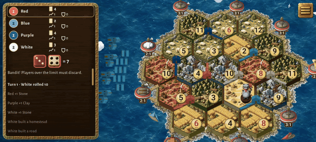
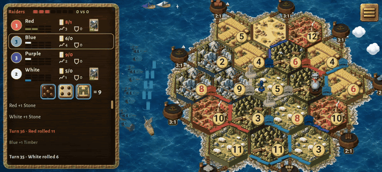
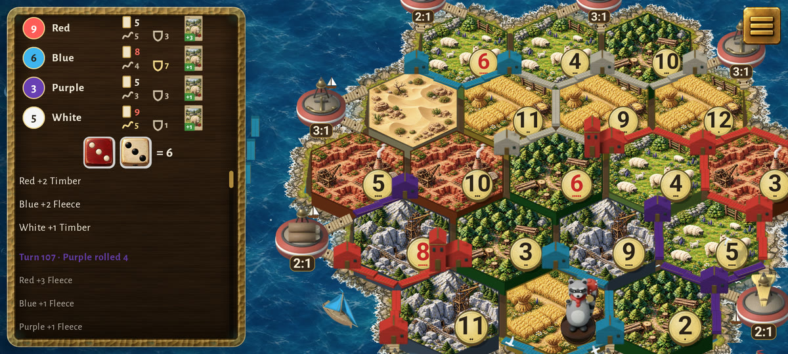
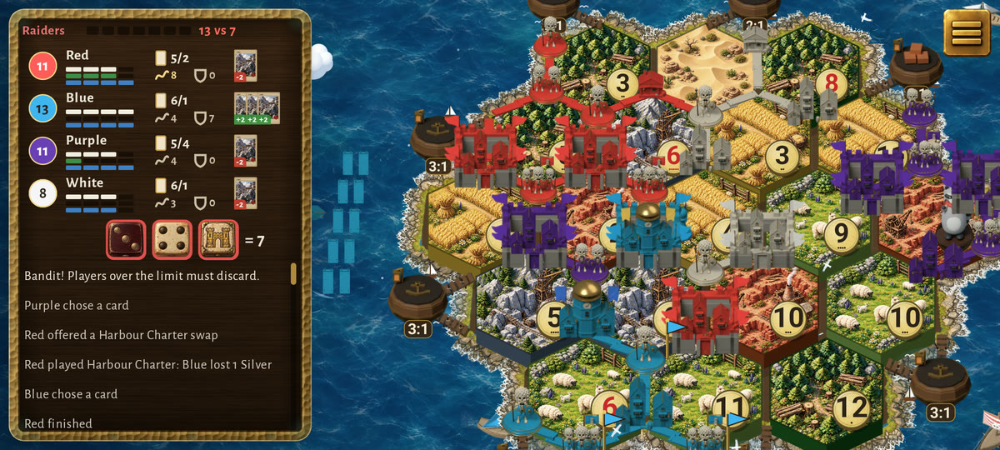
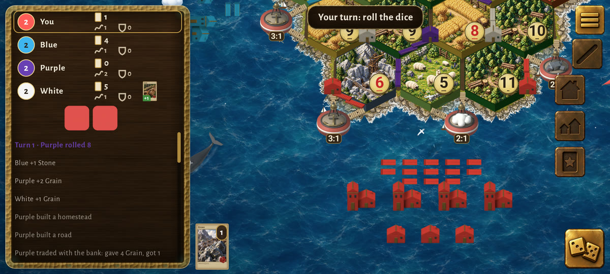
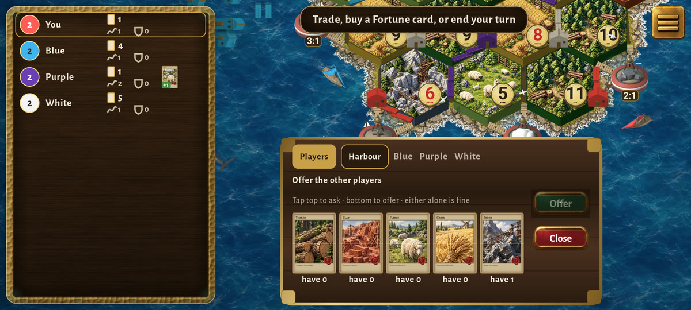
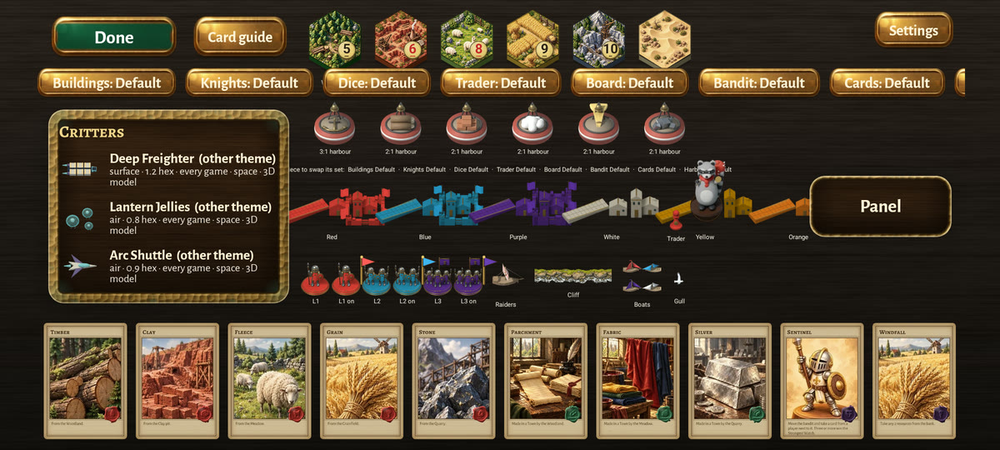
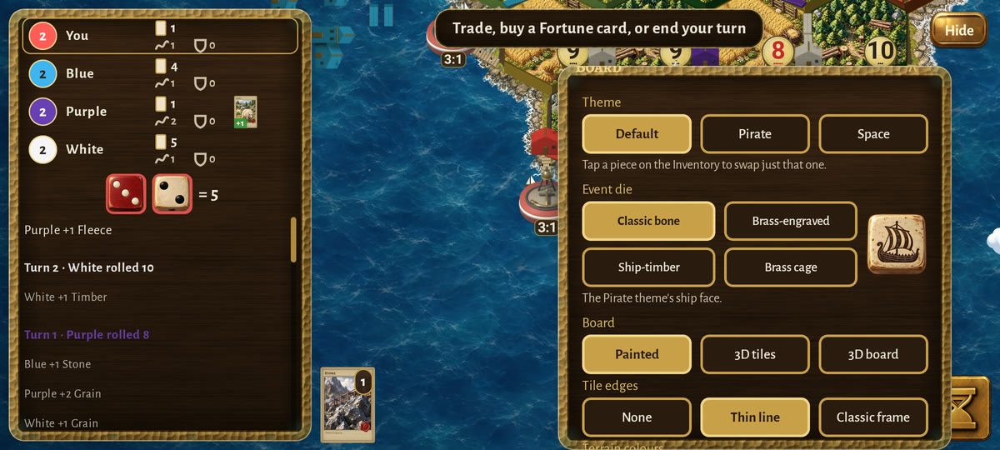

# Working German Board Game

A multiplayer board game of hex tiles, resources, trading and building, for Android and the web. Play 3 to 6 players
with friends online or against the built-in bots.

## Play it at **[workinggermanboardgame.com](https://workinggermanboardgame.com/)**

- **In your browser:** [workinggermanboardgame.com/play](https://workinggermanboardgame.com/play/) (phone, tablet or computer, nothing to install)
- **Android:** [download the current APK](https://github.com/cyclistmass/wgbg/releases/latest/download/working-german-board-game.apk) ([release notes](https://github.com/cyclistmass/wgbg/releases/latest))

The game moved to its own site. This page only points there and keeps the Android downloads.

## Screenshots

| | |
|---|---|
|  |  |
|  |  |
|  |  |

## Licences and trademarks

The app's code, art and audio belong to Coquina Technologies LLC: code under the PolyForm Noncommercial License 1.0.0
([LICENSE](LICENSE)), art and audio under CC BY-NC-SA 4.0 ([LICENSE-ART.md](LICENSE-ART.md)). Third-party parts are
listed in [CREDITS.md](CREDITS.md), with their licence texts in [docs/licenses](docs/licenses).

Working German Board Game is an original, independent game. It is not affiliated with, endorsed by or sponsored by
Catan GmbH, Catan Studio or any of their licensees. CATAN and Cities & Knights are trademarks of Catan GmbH.

Copyright (c) 2026 Coquina Technologies LLC.
